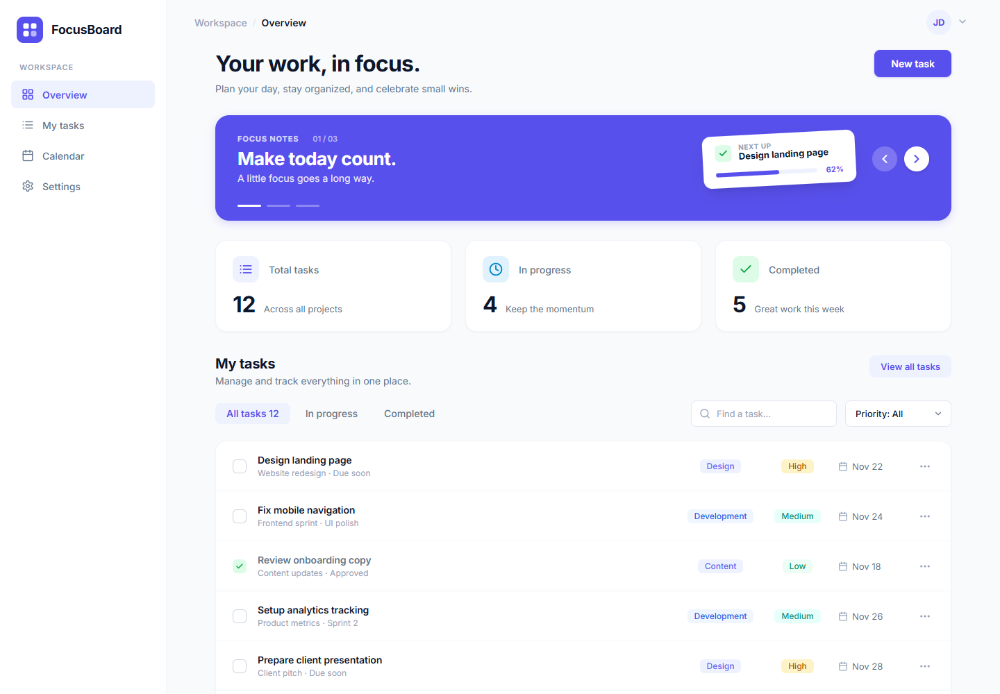
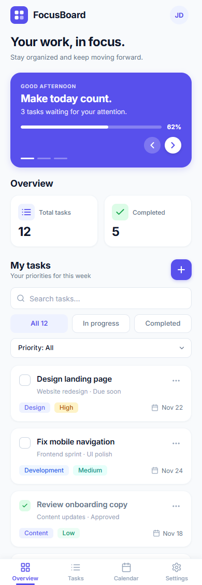

# FocusBoard — Portfolio Task Management Dashboard

FocusBoard is a professional, high-performance task management dashboard built for a frontend developer trainee assessment. It translates official Figma design references into an accessible, pixel-accurate single-page application with complete task CRUD operations, compound search/filtering, and seamless browser `localStorage` persistence.

---

## 1. Project Overview

FocusBoard delivers a focused daily task-planning experience for professionals. The application provides immediate visibility into personal priorities, progress metrics, and actionable tasks without unnecessary engineering complexity or external cloud service dependencies.

---

## 2. Problem Being Solved

Modern productivity tools are frequently overburdened with multi-tenant complexities, network latency, and cluttered user interfaces. FocusBoard solves this by providing:
- **Instant Client-Side Responsiveness**: Zero network round-trips for creating, editing, filtering, or deleting tasks.
- **Visual Clarity & Focus**: High-contrast, clean typography directly reflecting professional design tokens.
- **Uncompromised Mobile Experience**: Dedicated mobile navigation patterns rather than mere downscaled desktop layouts.
- **Reliable Local Persistence**: Automatic synchronization with browser storage, safeguarding work between sessions while honoring intentionally empty states.

---

## 3. Technology Stack

- **Core Library:** [React.js](https://react.dev/) (v18.3.1)
- **Tooling & Bundler:** [Vite](https://vitejs.dev/) (v6.0.1)
- **Language:** JavaScript (ES6+ / ES2022)
- **Styling:** Vanilla CSS3 with Figma Design Tokens (CSS Custom Properties)
- **Icons:** [Lucide React](https://lucide.dev/) (v0.460.0)
- **End-to-End QA:** [Playwright Test](https://playwright.dev/) (v1.57.0)
- **Persistence:** Web Storage API (`localStorage`)

---

## 4. Key Features Implemented

- **Interactive Application Shell**: Collapsible 240px desktop sidebar, compact 72px icon tablet sidebar, and fixed mobile bottom navigation bar with safe-area support.
- **Pixel-Accurate Branding**: Custom inline SVG brand emblem featuring the exact Figma 2×2 solid rounded squares (white & lavender accents on royal purple `#5850EC`).
- **Focus Notes 3-Slide Carousel**: Cyclical slide rotation with headline cards, progress metrics, forward/back buttons, and active indicator dashes.
- **Dynamic Real-Time Statistics**: Dynamically calculated metrics for *Total tasks*, *In progress*, and *Completed* reflecting all dataset mutations.
- **Complete Task CRUD**:
  - **Create Task Modal**: Matching Figma Frame `1:279` (760 × 822 canvas, 597px inner card), with field-specific validation.
  - **Edit Task Modal**: In-place task updates preserving immutable IDs and categories.
  - **Delete Confirmation Dialog**: Accessible alert dialog protecting against accidental deletion with default focus on Cancel.
  - **Quick Status Toggle**: Checkbox toggle flipping between `completed` and `todo`.
- **Compound Filtering & Search**:
  - Case-insensitive, title-based live search.
  - Three status filter tabs (`All`, `In progress`, `Completed`).
  - Priority dropdown filter (`All`, `High`, `Medium`, `Low`).
  - Coordinated empty state with one-click filter reset.

---

## 5. Visual References & Screenshots

### Desktop Dashboard (1440 × 1000 px)


### Mobile Dashboard (390 × 1128 px)


### Create & Edit Task Modal (Figma Frame 1:279)


### Delete Confirmation Dialog


---

## 6. Project Architecture & Directory Structure

```
focusboard-mobilefirst/
├── docs/
│   ├── FIGMA_AUDIT.md           # Figma dimensions, token mappings & frame audits
│   ├── IMPLEMENTATION_PLAN.md   # Architectural decisions & implementation log
│   └── design-references/       # Captured Figma source & rendered verification images
├── e2e/
│   └── focusboard.spec.js       # Playwright end-to-end automated QA test suite
├── screenshots/
│   ├── desktop.png              # 1440 × 1000 submission capture of running application
│   └── mobile.png               # 390 × 1128 submission capture of running application
├── src/
│   ├── assets/                  # Brand vectors and illustrations
│   ├── components/
│   │   ├── common/              # Reusable atomic components
│   │   │   └── BrandLogo.jsx    # Exact 2x2 solid rounded-square brand symbol
│   │   ├── layout/              # Shell, navigation bars, headers
│   │   │   ├── AppLayout.jsx    # Container orchestrator
│   │   │   ├── Sidebar.jsx      # Desktop / Tablet icon sidebar
│   │   │   ├── Header.jsx       # Breadcrumbs & mobile brand header
│   │   │   └── BottomNav.jsx    # Fixed mobile bottom navigation
│   │   ├── dashboard/           # Metrics & page heading
│   │   │   ├── DashboardHeading.jsx
│   │   │   ├── StatsGrid.jsx
│   │   │   └── StatCard.jsx
│   │   ├── carousel/            # Focus Notes banner carousel
│   │   │   ├── FocusNotesCarousel.jsx
│   │   │   └── FocusNotesSlide.jsx
│   │   └── tasks/               # Task management components
│   │       ├── TaskSection.jsx  # Section coordinator
│   │       ├── TaskFilters.jsx  # Search bar, status tabs, priority dropdown
│   │       ├── TaskTable.jsx    # Desktop rows & mobile card wrapper
│   │       ├── TaskRow.jsx      # Row/card item with action dropdown menu
│   │       ├── TaskModal.jsx    # Reusable Create & Edit Task Modal
│   │       └── ConfirmDeleteDialog.jsx # Accessible delete confirmation
│   ├── data/
│   │   ├── sampleTasks.js       # 12 seed tasks across 3 statuses
│   │   └── carouselSlides.js    # 3 official Focus Notes slide definitions
│   ├── hooks/
│   │   └── useTasks.js          # Single source of truth & localStorage sync
│   ├── utils/
│   │   └── dateUtils.js         # ISO-to-display date conversion helpers
│   ├── styles/
│   │   ├── variables.css        # Centralized Figma design tokens
│   │   ├── layout.css           # Shell and responsive navigation styles
│   │   ├── dashboard.css        # Heading, stats, and carousel styles
│   │   ├── tasks.css            # Task table, row, and mobile card styles
│   │   ├── modal.css            # Modal, dialog, and action popup styles
│   │   └── index.css            # Reset, typography, and master stylesheet imports
│   ├── App.jsx                  # Main dashboard state integration
│   └── main.jsx                 # React DOM mount entry
├── playwright.config.js         # Playwright test configuration
├── package.json                 # Project dependencies and npm scripts
├── AI_USAGE.md                  # Comprehensive AI usage disclosure
└── README.md                    # Project documentation
```

---

## 7. Getting Started Locally

### Prerequisites
- **Node.js**: v18.0.0 or higher (tested with v26.13.1)
- **npm**: v9.0.0 or higher (tested with v11.20.0)

### Installation & Run Steps

1. Clone or navigate to the project directory:
   ```bash
   cd focusboard-mobilefirst
   ```

2. Install dependencies:
   ```bash
   npm install
   ```

3. Launch the development server:
   ```bash
   npm run dev
   ```
   Open `http://localhost:5173` in your browser.

4. Build for production:
   ```bash
   npm run build
   ```

5. Preview the production build locally:
   ```bash
   npm run preview
   ```

6. Run the end-to-end Playwright test suite:
   ```bash
   npm test
   ```

---

## 8. State Management Approach: Why React Hooks?

FocusBoard deliberately utilizes idiomatic React Hooks (`useState`, `useMemo`, `useEffect`, `useRef`) consolidated inside the custom `useTasks` hook, intentionally rejecting external global state libraries like Redux or Zustand.

**Justification:**
1. **Appropriate Complexity (Ponytail Principle)**: FocusBoard is a single-user dashboard application. Adding Redux Toolkit or Zustand introduces unnecessary boilerplate (actions, reducers, dispatchers, store providers) for state that cleanly lives within a unified custom hook.
2. **Single Source of Truth**: `useTasks` maintains the primary `tasks` array. Derived states (statistics, search matches, active filter tabs) are calculated on-the-fly using `useMemo`, avoiding stale state bugs and synchronization overhead.
3. **Transparent Persistence**: A single `useEffect` observer inside `useTasks` synchronizes state changes to `localStorage` without dispatch middleware.
4. **Zero Bundle Bloat**: Eliminates third-party state libraries, keeping the JavaScript bundle at a lean 181 kB (56 kB gzipped).

---

## 9. Canonical Task Data Model

To ensure strict data integrity, all tasks conform to a single canonical schema:

```typescript
interface Task {
  id: string;               // Unique immutable ID (e.g. 'task-1' or 'task-1732320000-abcde')
  title: string;            // Required task title (trimmed whitespace)
  description: string;      // Detailed description subtext
  project: string;          // Secondary display line (e.g. 'Website redesign · Due soon')
  category: string;         // 'Design' | 'Development' | 'Content' | 'General'
  status: 'todo' | 'in_progress' | 'completed'; // Canonical enum (no competing booleans)
  priority: 'low' | 'medium' | 'high';         // Priority rating
  dueDate: string;          // Formatted due date string (e.g. 'Nov 25')
}
```

**Key Data Rules:**
- **No Competing Booleans**: Status is strictly dictated by the `status` enum.
- **Checkbox Behavior**: Toggling a task checkbox switches `status` between `'completed'` and `'todo'`.
- **Category Preservation**: Because Figma Frame `1:279` does not include a category input, new tasks receive the default category `'General'`; existing categories are strictly preserved during editing.

---

## 10. Search & Filtering Strategy

Filtering executes compound multi-criterion matching in a single `useMemo` pass:
1. **Status Filtering**: Matches active segmented tab (`all`, `in_progress`, `completed`).
2. **Priority Filtering**: Matches dropdown selection (`all`, `high`, `medium`, `low`).
3. **Title Search**: Strictly case-insensitive and title-based:
   ```javascript
   task.title.toLowerCase().includes(searchQuery.trim().toLowerCase())
   ```
4. **Empty State Handling**: When no tasks match, an empty state illustration is displayed with a "Reset filters" button that restores default views in one click.

---

## 11. LocalStorage Persistence Strategy

- **Storage Key**: `focusboard_tasks`
- **Initial Seed**: On the user's very first visit, 12 sample tasks from `sampleTasks.js` are seeded and persisted.
- **Subsequent Visits**: Saved tasks are parsed directly from `localStorage`.
- **Intentionally Empty State**: If a user deletes all tasks, `localStorage` stores `'[]'`. On subsequent reloads, the application respects the empty state and **never** overwrites user data with sample defaults.
- **Defensive Error Handling**: Safe `try/catch` wrapping protects against unavailable storage, corrupted non-array JSON, or quota exceptions.

---

## 12. Responsive Design Breakpoints

FocusBoard uses clean CSS media queries without heavy utility frameworks:

| Viewport | Range | Shell Layout | Task Representation | Stats Grid |
|---|---|---|---|---|
| **Desktop** | `≥ 1024px` (1440 × 1000 ref) | 240px Fixed Sidebar + Top Header | Full Table Rows with Meta Columns | 3 Columns |
| **Tablet** | `768px - 1023px` (768 × 1024 ref) | 72px Icon-Only Sidebar | Condensed Rows | 3 Columns |
| **Mobile** | `< 768px` (390 × 1128 ref) | Hidden Sidebar, Fixed Bottom Nav | Stacked Touch-Friendly Cards | 2 Columns (Total & Completed) |

---

## 13. Accessibility & WAI-ARIA Considerations

- **Semantic HTML**: `<aside>`, `<header>`, `<main>`, `<nav>`, `<section>`, and `<h1>`–`<h4>` structure.
- **Modal Dialog Semantics**: `role="dialog"` on `TaskModal` and `role="alertdialog"` on `ConfirmDeleteDialog`.
- **Focus Trapping**: Keyboard `Tab` and `Shift+Tab` cycling is trapped within active modals, preventing users from tabbing into obscured background content.
- **Accidental Deletion Protection**: Delete confirmation initially focuses the **Cancel** button.
- **Focus Restoration**: Closing any modal automatically returns keyboard focus to the triggering element.
- **Escape Key Dismiss**: Pressing `Escape` closes active dialogs safely.
- **Color Independence**: Badges and status indicators pair color with text labels and distinct icons.
- **Reduced Motion**: Smooth transitions respect user OS preferences.

---

## 14. Testing & Quality Assurance

A comprehensive automated test suite built with **Playwright** verifies all critical journeys:

```bash
npm test
```

### Verified Test Suites:
- **Suite A (Dashboard)**: Initial loading, 12 sample tasks, dynamic stats derivation, 3-slide carousel cycling.
- **Suite B (Task Creation)**: Empty title rejection, whitespace rejection, successful task creation.
- **Suite C (Task Editing)**: In-place editing of title, priority, status without duplicates.
- **Suite D (Task Deletion)**: Cancel retaining tasks, confirm removing tasks, stats update.
- **Suite E (Search & Compound Filters)**: Case-insensitive search, status tabs, priority filter, empty state reset.
- **Suite F (Persistence)**: Task creation reload, status toggle reload, empty list reload persistence.
- **Suite G (Responsive Behavior)**: Viewport testing at 390px, 768px, 1440px with zero horizontal overflow.
- **Suite H (Accessibility)**: WAI-ARIA attributes, focus trapping, Escape handling.

---

## 15. Known Limitations

- **Category Field in Modal**: The Figma design references for Frame `1:279` omit a Category input; new tasks default to `'General'` while existing task categories are retained during edits.
- **Native Date Picker Styling**: Native browser date pickers (`::-webkit-calendar-picker-indicator`) render system calendar dialogs that cannot be fully customized via CSS.

---

## 16. Repository & Hosting Details

- **Local Project Directory:** `focusboard-mobilefirst`
- **Git Branch:** `main`
- **GitHub Repository URL:** `https://github.com/eshwarrao123/focusboard-mobilefirst.git`
- **Deployment Strategy:** Production build output (`dist/`) is pre-compiled and fully static, ready for deployment to Vercel, Netlify, or GitHub Pages.
